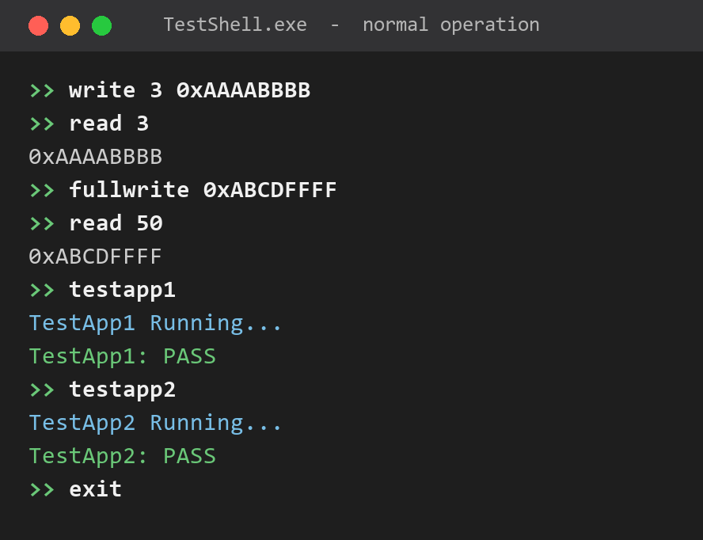
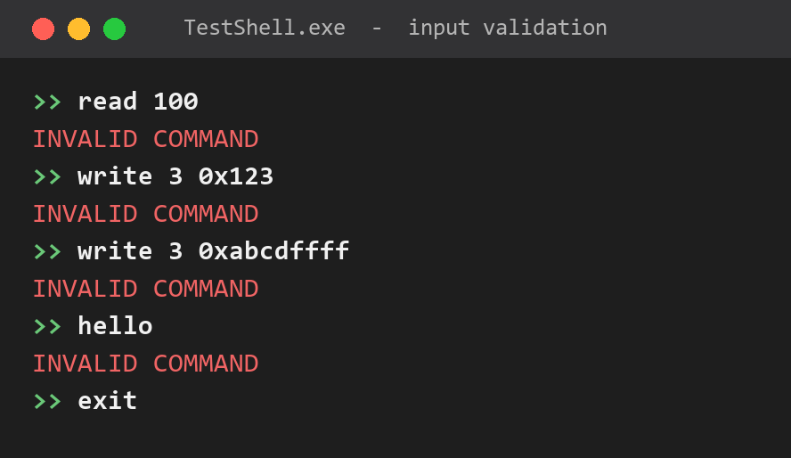

# Virtual SSD Test Shell

C로 SSD 컨트롤러의 **LBA 단위 읽기와 쓰기**를 구현한 프로젝트입니다. txt 파일로 NAND를 흉내 낸 **가상 SSD**와, 이를 검증하는 **Test Shell** 및 자동 테스트 스크립트로 구성됩니다.

- 과정: SSAFY 16기 임베디드 트랙, 임베디드 C언어
- 인원: 1명 (과제는 2인 1조였지만 설계부터 테스트까지 혼자 진행)
- 사용 기술: C언어, 파일 I/O, 프로세스 호출(Test Shell에서 `ssd` 실행), 입력 유효성 검사, 테스트 자동화
- 환경: Windows, Eclipse CDT

---

## 프로젝트 배경

### SSD란?
SSD(Solid State Drive)는 NAND 플래시 메모리에 데이터를 저장하는 저장 장치입니다. 호스트(PC)는 "몇 번 칸(LBA, Logical Block Address)에 이 값을 써라 / 읽어라"처럼 **논리 주소**로만 요청하고, SSD 안의 **컨트롤러와 펌웨어(FTL, Flash Translation Layer)**가 이 논리 주소를 실제 NAND의 물리 위치로 바꿔서 읽고 씁니다.

### read/write가 비정상이 되는 이유
호스트 입장에서는 "쓴 값이 그대로 읽힌다"가 당연해 보이지만, SSD 내부에서는 이 약속이 깨질 수 있는 지점이 많습니다.

- **NAND 자체의 물리적 한계**: NAND 셀은 쓰고 지우기(P/E cycle)를 반복할수록 닳고, 시간이 지나면 저장된 전하가 빠지며(retention), 옆 셀을 반복해서 읽는 것만으로도 영향을 받습니다(read disturb). 그 결과 비트가 뒤집힐 수 있습니다.
- **덮어쓰기가 안 되는 구조**: NAND는 지운 뒤에만 다시 쓸 수 있고, 지우는 단위(블록)가 쓰는 단위(페이지)보다 큽니다. 그래서 펌웨어가 주소 매핑, 가비지 컬렉션, 웨어 레벨링을 직접 관리해야 하고, 이 로직에 버그가 있으면 다른 위치의 데이터나 예전 데이터가 읽힙니다.
- **경계 조건과 예외 상황**: 범위를 벗어난 LBA, 형식이 잘못된 요청, 쓰는 도중의 전원 차단 같은 상황을 펌웨어가 제대로 처리하지 못하면 데이터가 깨지거나 장치가 멈출 수 있습니다.

### 그래서 검증 쉘이 필요한 이유
펌웨어는 계속 수정되기 때문에, 바뀔 때마다 **"쓴 값이 그대로 읽히는가"를 전체 영역과 경계 조건까지 반복해서 확인**해야 합니다. 이 작업을 사람이 손으로 하면 느리고 빠뜨리기 쉽기 때문에, 명령어로 읽기/쓰기를 내리고 정해진 시나리오를 자동으로 돌려 PASS/FAIL을 판정하는 **테스트 셸과 테스트 스크립트**가 필요합니다.

이 프로젝트는 그 검증 흐름을 작은 규모로 직접 구현해 본 것입니다. `nand.txt`로 NAND를 흉내 낸 가상 SSD를 두고, Test Shell에서 `write / read / fullwrite / fullread` 명령과 `testapp1`(전체 쓰기 후 비교), `testapp2`(같은 칸 반복 쓰기와 덮어쓰기 후 비교) 시나리오로 동작을 검증했습니다. 범위 밖 LBA나 잘못된 값 같은 비정상 입력도 셸과 SSD 양쪽에서 걸러내도록 했고, 저장 중 실패에 대비해 임시 파일에 먼저 쓰고 교체하는 방식을 썼습니다. 단, 이 가상 SSD는 LBA 단위 읽기/쓰기와 검증 흐름에 집중했고, NAND의 물리적 특성(블록 지우기, 마모 등)까지 모델링하지는 않았습니다.

---

## 1. 내가 맡은 역할

1. **nand.txt 저장 형식 설계**: 100줄로 만들어 줄 번호가 곧 LBA가 되게 했고, 임시 파일에 먼저 쓴 뒤 바꿔치기하는 방식으로 저장했습니다.
2. **Test Shell 구현**: 명령을 반복해서 받는 셸을 만들고, `system()`으로 `ssd`를 실행해 종료 코드로 성공 여부를 판단했습니다.
3. **이중 입력 검증**: 셸과 SSD 양쪽에서 입력을 한 번씩 검증했습니다.
4. **테스트 시나리오**: `testapp1`과 `testapp2` 테스트 시나리오를 구현했습니다.

---

## 2. 구조와 동작 흐름


| 구성 | SSD 구조에서의 역할 | 설명 |
|---|---|---|
| `TestShell` (`src/TestShell.c`) | 호스트 | 사용자 명령을 받아 `ssd`를 실행하고, 종료 코드와 `result.txt`로 결과를 받음 |
| `ssd` (`src/ssd.c`) | 컨트롤러 | 한 번 실행할 때 명령 하나(`W` 또는 `R`)를 처리 |
| `nand.txt` | NAND | 100줄, 줄 번호 = LBA |
| `result.txt` | 읽기 결과 | 마지막 Read 결과 한 줄 |

---

## 3. 핵심 구현

### 데이터 규격
| 항목 | 규격 |
|---|---|
| LBA | 0 ~ 99, 10진수 |
| 값 | `0x` + 대문자 HEX 8자리 (예: `0x1234ABCD`) |
| 초기값 | 한 번도 안 쓴 LBA는 `0x00000000` |

### 가상 SSD 명령
| 명령 | 동작 |
|---|---|
| `ssd W 3 0xAAAABBBB` | nand.txt를 읽어 LBA 3 값을 바꾼 뒤 100줄 전체를 다시 저장 |
| `ssd R 3` | LBA 3 값을 result.txt에 한 줄로 덮어쓰기 |
| 형식 오류 | `INVALID COMMAND` 출력, 종료 코드 1 |

### nand.txt 형식과 저장 방식
```
0x12345678   ← LBA 0
0x12345678   ← LBA 1
...
0x00000000   ← LBA 99
```
- 값이 정확히 100개가 아니거나 형식이 틀리면 `NAND FILE ERROR`
- `nand.txt.tmp`에 전체를 쓰고 → 기존 파일 삭제 → 이름 변경. 쓰는 도중 실패해도 기존 데이터가 남음

### Test Shell 명령
| 명령 | 동작 |
|---|---|
| `write [LBA] [값]` | 한 LBA에 쓰기 |
| `read [LBA]` | 한 LBA를 읽어 값 출력 |
| `fullwrite [값]` | LBA 0~99 전체에 같은 값 쓰기 |
| `fullread` | LBA 0~99 전체 출력 (`LBA n : 값`) |
| `testapp1` | `0xABCDFFFF` 전체 쓰기 → 전부 읽어 비교 → PASS/FAIL |
| `testapp2` | LBA 0~5에 `0xAAAABBBB` 30회 쓰기 → `0x12345678` 덮어쓰기 → 비교 → PASS/FAIL |
| `help` | 명령 목록 출력 |
| `exit` | 종료 |

### 입력 처리
- `fgets()`로 최대 255글자 입력, 넘치면 남은 입력을 버리고 거부
- `strtok()`으로 공백 기준 분리, 단어가 4개를 넘거나 명령별 인자 개수가 틀리면 거부
- LBA는 숫자인지 먼저 확인한 뒤 `atoi()`로 변환

명령별 검증 규칙, 출력 메시지, 종료 코드는 [상세 구현 명세](docs/detailed_spec.md)에 정리했습니다.

---

## 4. 어려웠던 문제와 해결 과정

**어려웠던 점**
구분자를 기준으로 문자열을 파싱할 때, Python의 `split()`은 나눈 결과를 리스트로 바로 돌려주지만 C의 `strtok()`은 호출할 때마다 토큰을 하나씩만 돌려줍니다. 그래서 명령어 문자열(`write 3 0xAAAABBBB`)을 인자별로 나누는 데 어려움을 겪었습니다.

**원인 분석**
`strtok()`의 동작 방식을 이해하지 못했던 것이 원인이었습니다.
- 첫 호출에는 원본 문자열을 넘기고, 이후에는 `NULL`을 넘겨야 이전 위치부터 이어서 자릅니다. 함수 내부에 다음 시작 위치를 기억하기 때문입니다.
- 새 배열을 만드는 것이 아니라 원본 문자열의 구분자 자리를 `'\0'`으로 바꾸고, 각 토큰의 시작 주소(포인터)를 돌려줍니다.

**해결**
`while`문으로 `strtok()`이 `NULL`을 돌려줄 때까지 반복하면서, 돌려받은 포인터를 `char*` 배열에 차례로 저장했습니다. 그 결과 Python의 `split()`처럼 인자 배열을 만들고 인자 개수까지 함께 셀 수 있게 되었습니다.

```c
/* src/TestShell.c */
int parseInput(char *input, char *args[], int maxArgs)
{
    int count = 0;
    char *token = strtok(input, " \t\r\n");

    while (token != NULL) {
        if (count >= maxArgs)
            return -1;

        args[count++] = token;
        token = strtok(NULL, " \t\r\n");
    }

    return count;
}
```

---

## 5. 결과

### 정상 기능 PASS



- `write 3 0xAAAABBBB` → `read 3`: Test Shell이 `ssd W 3 0xAAAABBBB`를 실행하면 nand.txt의 3번 줄(LBA 3)에 값이 저장됩니다. `read 3`은 `ssd R 3`을 실행해 그 줄을 result.txt에 쓰고, Test Shell이 그 파일을 읽어 화면에 출력합니다. 같은 값이 나오면 쓰기와 읽기가 맞게 동작한 것입니다.
- `fullwrite 0xABCDFFFF` → `read 50`: LBA 0부터 99까지 모두 같은 값을 쓰기 때문에, 아무 칸(50번)을 읽어도 그 값이 나옵니다.
- **testapp1 PASS**: 전체 쓰기를 한 뒤 100칸을 모두 읽어서 쓴 값과 하나씩 비교합니다. 하나도 다르지 않아서 PASS.
- **testapp2 PASS**: LBA 0~5에 `0xAAAABBBB`를 30번 쓰고, `0x12345678`로 한 번 덮어쓴 뒤 읽습니다. 마지막에 쓴 값(`0x12345678`)이 그대로 읽혀서 PASS. 같은 칸을 여러 번 써도 마지막 값이 정확히 남는다는 것을 확인했습니다.

### 입력 검증



- `read 100`: `validLBA()`에서 걸립니다. 길이가 2자리를 넘으면 거부하고(`strlen(str) > 2`), 숫자도 0~99 범위여야 합니다. `"100"`은 3자리라 여기서 바로 실패합니다.
- `write 3 0x123`: `validValue()`는 값의 길이가 정확히 10자(`0x` + 16진수 8자리)여야 통과시킵니다. `"0x123"`은 5자라서 실패합니다.
- `write 3 0xabcdffff`: 길이는 10자로 맞지만, 각 자리가 `'0'~'9'` 또는 대문자 `'A'~'F'`인지만 확인합니다. 소문자 a~f는 허용하지 않아서 실패합니다.
- `hello`: 등록된 명령(`write`, `read`, `fullwrite` 등)과 `strcmp`로 비교했을 때 일치하는 것이 없어서 `INVALID COMMAND`가 나옵니다.

---

## 6. 배운 점

1. **입력 파싱과 예외 처리**: `strtok`, `strcmp`, `isdigit` 등으로 명령을 해석하고, LBA 범위와 16진수 형식을 검증해서 어떤 입력에도 segfault가 나지 않게 했습니다.
2. **SSD 구조 이해**: 호스트(Test Shell), 컨트롤러(ssd), NAND(nand.txt)로 역할을 나누고 LBA 단위로 읽고 쓰는 흐름을 구현했습니다.
3. **검증 관점의 테스트 자동화**: testapp1과 testapp2로 쓰고 읽어서 비교하는 검증 스크립트를 만들었습니다. 스토리지 회사의 검증 직무와 직접 연결되는 경험입니다.
4. **C 표준 라이브러리 문자열 함수**: `fgets`, `strtok`, `strcmp`, `isdigit`, `atoi`로 명령어를 파싱하면서 각 함수의 동작 방식을 익혔습니다.

---

## 빌드와 실행

> `src/TestShell.c`의 `SSD_PATH`, `SSD_DIR`은 개발 PC 기준 절대 경로입니다. 실행 전에 본인 환경에 맞게 바꿔야 합니다.

```bat
gcc src\ssd.c -o SSD_C.exe
gcc src\TestShell.c -o TestShell.exe
TestShell.exe
```

```
>> write 3 0xAAAABBBB
>> read 3
0xAAAABBBB
>> testapp1
TestApp1 Running...
TestApp1: PASS
```

---

## 개선할 점
- 실행 파일 경로 하드코딩 제거 (실행 위치 기준 상대 경로 또는 인자로 받기)
- 기존 파일 삭제와 이름 변경 사이에 종료되면 nand.txt가 사라지는 문제
- fullwrite 한 번에 ssd.exe를 100번 실행하는 비용
- 다음 단계: Linux nandsim 위에서 NAND 규칙(페이지 쓰기, 블록 지우기)을 지키는 FTL로 확장
