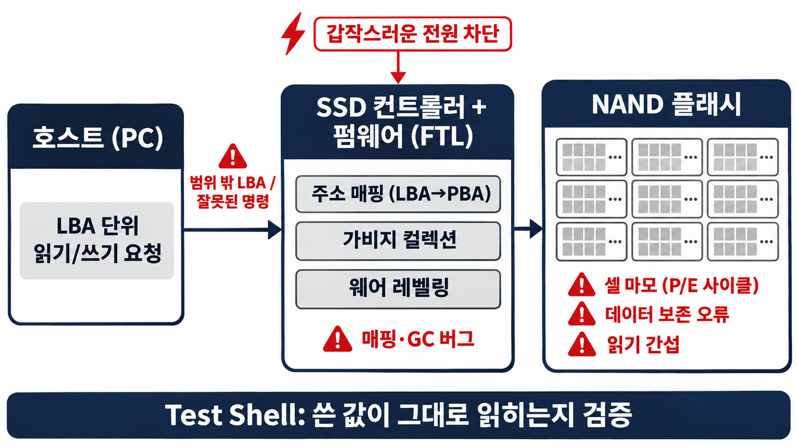
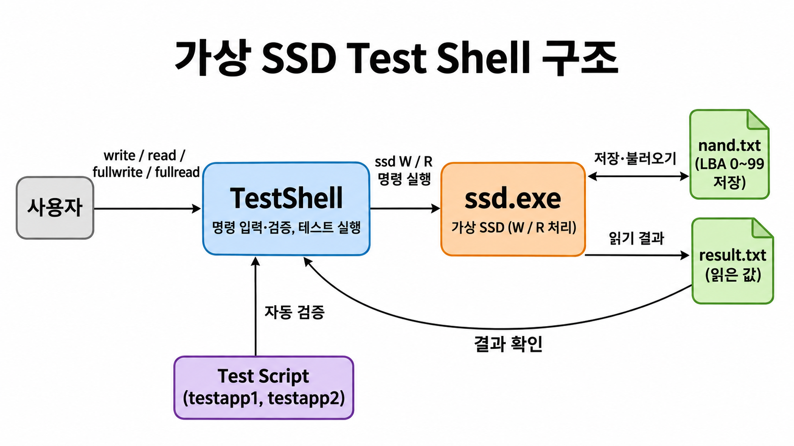

# Virtual SSD Test Shell

텍스트 파일(`nand.txt`)을 저장 매체로 쓰는 가상 SSD 프로그램과, 이 프로그램에 읽기/쓰기 명령을 내리고 결과를 자동으로 비교하는 Test Shell을 C로 만든 프로젝트다.

- 가상 SSD(`src/ssd.c`): 실행할 때마다 명령 하나(`W` 쓰기 / `R` 읽기)를 처리하는 독립 프로그램. LBA 0~99에 32비트 값 하나씩 저장한다.
- Test Shell(`src/TestShell.c`): 사용자 명령을 받아 `system()`으로 가상 SSD를 실행하고, 종료 코드와 `result.txt`로 결과를 받는다. 전체 쓰기/읽기와 자동 검증 시나리오(`testapp1`, `testapp2`)를 내장했다.
- 입력은 Test Shell과 가상 SSD 양쪽에서 각각 검증하고, 저장은 임시 파일에 먼저 쓴 뒤 교체한다.
- 실제 NAND 동작이나 FTL(주소 매핑, 가비지 컬렉션 등)은 구현하지 않았다. 범위는 [구현 범위](#구현-범위)에 정리했다.

| 항목 | 내용 |
|---|---|
| 과정 | SSAFY 16기 임베디드 트랙, 임베디드 C언어 |
| 인원 | 1명 (과제는 2인 1조였지만 설계부터 테스트까지 혼자 진행) |
| 사용 기술 | C, 표준 파일 I/O, `system()` 프로세스 호출, 문자열 파싱과 입력 검증, 셸 스크립트 테스트 |
| 개발 환경 | Windows, Eclipse CDT |

---

## 프로젝트 배경

### SSD와 검증
SSD에서 호스트(PC)는 "LBA 3번에 이 값을 써라", "LBA 3번을 읽어라"처럼 논리 주소(LBA, Logical Block Address)로만 요청한다. 논리 주소를 NAND의 물리 위치로 바꾸고 실제로 읽고 쓰는 일은 SSD 내부의 컨트롤러와 펌웨어(FTL)가 맡는다.



*실제 SSD의 구조를 설명하는 개념도다. 이 프로젝트는 그림 속 FTL과 NAND 내부 동작을 구현하지 않았다.*

이 과정에서 read/write 결과가 틀어질 수 있는 원인은 크게 세 가지다.

- NAND의 물리적 한계: 셀은 쓰고 지우기(P/E cycle)를 반복할수록 닳고, 시간이 지나면 전하가 빠지며(retention), 이웃 셀을 반복해서 읽는 것만으로도 영향을 받는다(read disturb).
- 덮어쓰기가 안 되는 구조: NAND는 지운 뒤에만 쓸 수 있고 지우는 단위(블록)가 쓰는 단위(페이지)보다 크다. 그래서 펌웨어가 매핑, 가비지 컬렉션, 웨어 레벨링을 관리해야 하고, 여기에 버그가 있으면 다른 데이터나 예전 데이터가 읽힌다.
- 경계 조건과 예외 상황: 범위 밖 LBA, 형식이 틀린 요청, 쓰는 도중의 전원 차단 등을 제대로 처리하지 못하면 데이터가 깨진다.

펌웨어가 바뀔 때마다 "쓴 값이 그대로 읽히는지"를 전체 영역과 경계 조건까지 다시 확인해야 하고, 이 반복 작업을 자동화하는 것이 테스트 셸과 테스트 시나리오의 역할이다. 이 프로젝트는 그 흐름 중 호스트 쪽, 즉 명령을 내리고 결과를 비교하는 부분을 작은 규모로 구현한 것이다.

### 구현 범위

| 구현한 것 | 구현하지 않은 것 |
|---|---|
| 파일 기반 LBA 저장 (`nand.txt`, LBA 0~99) | NAND 페이지 쓰기, 블록 지우기 |
| `W` / `R` 명령 처리와 종료 코드 | FTL의 논리-물리 주소 매핑 |
| Test Shell의 명령 입력, 파싱, 외부 프로세스 실행 | 가비지 컬렉션, 웨어 레벨링 |
| Test Shell과 가상 SSD 양쪽의 입력 검증 | ECC 등 오류 정정 |
| 임시 파일을 거치는 저장, NAND 파일 형식 검사 | 실제 SSD 하드웨어 제어, 전원 차단 복구 |
| 자동 검증 시나리오 `testapp1`, `testapp2` | |

실제 SSD에서 LBA 하나는 보통 512바이트나 4KiB 섹터를 가리킨다. 이 프로젝트에서는 LBA 하나에 32비트 값 하나(`0x` + 16진수 8자리 텍스트)만 저장하도록 단순화했다.

---

## 1. 내가 맡은 역할

1. `nand.txt` 저장 형식 설계: 100줄 고정, 줄 번호가 곧 LBA. 쓰기는 임시 파일에 먼저 쓴 뒤 기존 파일과 교체한다.
2. 가상 SSD 구현: 명령행 인자 검증, NAND 파일 적재/검사, 쓰기와 읽기, 종료 코드 설계 (`src/ssd.c`)
3. Test Shell 구현: 명령 반복 입력, `strtok()` 기반 파싱, `system()`으로 가상 SSD 실행, `result.txt` 읽기 (`src/TestShell.c`)
4. 이중 입력 검증: 같은 규칙(`validLBA()`, `validValue()`)을 Test Shell과 가상 SSD에 각각 적용
5. 자동 검증 시나리오: `testapp1`, `testapp2` 구현

---

## 2. 구조와 동작 흐름



*그림의 "Test Script"(`testapp1`, `testapp2`)는 별도 파일이 아니라 Test Shell 안에 들어 있는 명령이다. `ssd.exe`는 가상 SSD 실행 파일을 가리키며, 개발 환경(Eclipse)에서의 실제 파일 이름은 `SSD_C.exe`다.*

| 구성 | 실제 SSD에 비유하면 | 역할 |
|---|---|---|
| Test Shell (`src/TestShell.c`) | 호스트 | 명령을 받아 검증한 뒤 가상 SSD를 실행하고, 종료 코드와 `result.txt`로 결과를 받는다 |
| 가상 SSD (`src/ssd.c`) | 컨트롤러 | 한 번 실행에 명령 하나(`W` 또는 `R`)를 처리하고 종료한다 |
| `nand.txt` | NAND | LBA 0~99의 값을 100줄 텍스트로 저장한다 |
| `result.txt` | 읽기 결과 전달 | 마지막 `R` 결과 한 줄 |

명령 하나가 처리되는 순서는 다음과 같다.

```
read 3 입력
 → TestShell: parseInput()으로 분리, validLBA("3") 확인
 → runSSD("R 3"): system("cd /d <SSD_DIR> && <SSD_PATH> R 3")
 → ssd: 인자 검증 → loadNAND()로 nand.txt 100개 값 적재 → readSSD()가 result.txt에 기록 → 종료 코드 0
 → TestShell: 종료 코드 0이면 result.txt를 읽고 validValue()로 한 번 더 확인한 뒤 출력
```

---

## 3. 핵심 구현

### 데이터 규격
| 항목 | 규격 |
|---|---|
| LBA | `0` ~ `99`, 10진수 숫자 1~2자리 (`07`처럼 앞에 0이 붙은 두 자리도 허용) |
| 값 | `0x` + 대문자 16진수 8자리, 총 10글자 (예: `0x1234ABCD`) |
| 초기값 | 한 번도 쓰지 않은 LBA는 `0x00000000` |

### 가상 SSD 명령 (`src/ssd.c`)
| 명령 | 동작 | 출력 / 종료 코드 |
|---|---|---|
| `ssd W 3 0xAAAABBBB` | `nand.txt`를 읽어 LBA 3만 바꾼 뒤 100줄 전체를 다시 저장 | 성공 시 출력 없음, `0` |
| `ssd R 3` | LBA 3 값을 `result.txt`에 한 줄로 덮어쓴다 | 성공 시 출력 없음, `0` |
| 인자 개수, 명령, LBA, 값 형식 오류 | 처리하지 않음 | `INVALID COMMAND` (stdout), `1` |
| `nand.txt` 형식 오류 | 처리하지 않음 | `NAND FILE ERROR` (stderr), `1` |
| 파일 쓰기 실패 | - | `SSD WRITE FAILED` / `SSD READ FAILED` (stderr), `1` |

`nand.txt`가 없으면 모든 LBA를 `0x00000000`으로 보고 동작한다. 읽기만 해서는 `nand.txt`가 생기지 않고, 첫 쓰기 때 100줄 전체가 만들어진다.

### `nand.txt` 형식
```
0x12345678   ← LBA 0
0x12345678   ← LBA 1
...
0x00000000   ← LBA 99
```
`loadNAND()`는 값을 정확히 100개 읽고, 각 값이 `validValue()`를 통과하는지 확인한다. 값이 모자라거나 남거나 형식이 하나라도 틀리면 `NAND FILE ERROR`로 종료하고 파일을 건드리지 않는다.

### 저장 절차 (`saveNAND()`)
1. `nand.txt.tmp`를 열어 100줄 전체를 쓴다.
2. 쓰기나 `fclose()`가 실패하면 `.tmp`를 지우고 실패를 반환한다. 이때 기존 `nand.txt`는 그대로 남는다.
3. 기존 `nand.txt`를 `remove()`로 지운다. (Windows의 `rename()`은 대상 파일이 있으면 실패하기 때문)
4. `nand.txt.tmp`를 `nand.txt`로 `rename()`한다.

이 방식이 막아 주는 경우와 막지 못하는 경우는 [4-B](#b-저장-과정의-안정성)에 정리했다.

### Test Shell 명령 (`src/TestShell.c`)
| 명령 | 동작 |
|---|---|
| `write [LBA] [값]` | `ssd W` 1회 실행 |
| `read [LBA]` | `ssd R` 1회 실행 후 `result.txt` 값 출력 |
| `fullwrite [값]` | LBA 0~99에 차례로 `ssd W` 100회 실행. 중간에 실패하면 멈춘다 |
| `fullread` | LBA 0~99를 차례로 읽어 `LBA n : 값` 형식으로 출력 |
| `testapp1` | `0xABCDFFFF` 전체 쓰기 → 100칸을 읽어 비교 → `PASS`/`FAIL` |
| `testapp2` | LBA 0~5에 `0xAAAABBBB` 쓰기를 5회 반복(총 30회) → `0x12345678`로 덮어쓰기 → LBA 0~5를 읽어 비교 → `PASS`/`FAIL` |
| `help` | 명령 목록 출력 |
| `exit` | 종료 (입력이 EOF로 끝나도 종료) |

### 입력 검증
| 검사 | 위치 | 규칙 |
|---|---|---|
| 줄 길이 | Test Shell `main()` | `fgets()` 버퍼 256바이트. 254자까지 한 줄로 처리하고, 255자 이상이면 남은 입력을 버리고 `INVALID COMMAND` |
| 단어 수 | Test Shell `parseInput()` | 공백·탭 기준 분리. 단어가 4개를 넘으면 `INVALID COMMAND`. 빈 줄은 무시 |
| 명령과 인자 개수 | Test Shell `main()` | `strcmp()`로 명령을 찾고, 명령별 인자 개수가 다르면 `INVALID COMMAND` |
| LBA | 양쪽 `validLBA()` | 비어 있지 않고, 2자리 이하, 모두 숫자, 0~99. 통과한 뒤에만 `atoi()`로 변환 |
| 값 | 양쪽 `validValue()` | 길이 10, `0x`로 시작, 나머지 8자리가 `0-9` 또는 `A-F` |
| 명령행 인자 | 가상 SSD `main()` | 인자 3~4개, 명령은 대문자 `W`/`R`만, `W`는 값 필수, `R`은 값이 있으면 거부 |
| 읽어 온 결과 | Test Shell `readSSD()` | `result.txt`에서 `%10s`로 최대 10글자만 읽고 `validValue()`로 다시 확인 |

자세한 출력 메시지와 코드 위치는 [상세 구현 명세](docs/detailed_spec.md)에 정리했다.

---

## 4. 어려웠던 문제와 해결 과정

### A. 파일 기반 저장 구조
가상 SSD는 명령 하나를 처리하고 바로 종료하는 프로그램이라, 실행과 실행 사이에 데이터를 남기려면 파일에 저장해야 한다. `nand.txt`를 "100줄 고정, 줄 번호 = LBA"로 정해서, 파일을 열어 보는 것만으로 어느 LBA에 무엇이 있는지 확인할 수 있게 했다. 줄 수와 값 형식이 고정되어 있어서 `loadNAND()`에서 손상 여부를 단순하게 검사할 수 있다.

대신 쓰기 한 번마다 파일 전체를 읽고 100줄을 모두 다시 쓴다. LBA가 100개라서 문제가 되지 않는 크기지만, 용량이 커지면 쓰기 비용이 전체 크기에 비례해서 늘어나는 구조다.

### B. 저장 과정의 안정성
`nand.txt`를 바로 `"w"` 모드로 열면 그 순간 기존 내용이 비워지기 때문에, 쓰는 도중 실패하면 데이터 전체가 사라진다. 그래서 `nand.txt.tmp`에 먼저 다 쓴 뒤 교체하도록 했다.

| 실패 시점 | 결과 |
|---|---|
| `.tmp` 쓰기 또는 `fclose()` 실패 | `.tmp`만 지워지고 기존 `nand.txt`는 그대로 남는다 |
| 기존 `nand.txt` 삭제 실패 | 교체를 중단하고 기존 파일을 유지한다 |
| 삭제 후 `rename()` 실패, 또는 그 사이에 프로세스 종료 | `nand.txt`는 없고 `.tmp`에만 데이터가 남는다 |

마지막 경우가 남은 위험이다. 다음 실행에서 `loadNAND()`는 `nand.txt`가 없으면 빈 SSD로 처리하기 때문에 오류 없이 모든 값이 `0x00000000`으로 읽힌다. 그 상태로 쓰기를 하면 `.tmp`도 새 내용으로 덮어써져 이전 데이터를 되살릴 수 없다. Linux에서 `nand.txt`를 지우고 `.tmp`만 남긴 상태를 만들어 이 동작을 직접 확인했다. 또 `fclose()`는 OS 버퍼까지만 보장하기 때문에 전원 차단 상황의 무결성은 이 구조로 보장되지 않는다.

### C. 이중 입력 검증
Test Shell에서 이미 검사한 입력을 가상 SSD에서도 다시 검사한다. 가상 SSD는 Test Shell 없이 명령행에서 직접 실행할 수 있는 독립 프로그램이기 때문에, 자기 입력을 스스로 검증해야 잘못된 LBA로 배열 밖을 쓰는 일이 없다. Test Shell 쪽 검사는 잘못된 입력을 프로세스를 띄우기 전에 걸러내고, 사용자에게 바로 `INVALID COMMAND`를 보여 주는 역할을 한다. 두 파일의 `validLBA()`, `validValue()`는 같은 규칙을 따로 구현한 것이라, 규칙을 바꿀 때 두 곳을 같이 고쳐야 한다.

### D. 명령 파싱 (`strtok()`)
처음에는 Python의 `split()`처럼 한 번에 리스트를 돌려받는 함수를 기대했지만, C의 `strtok()`은 호출할 때마다 토큰을 하나씩 돌려준다. 동작 방식을 확인해 보니 다음과 같았다.

- 첫 호출에는 원본 문자열을, 이후에는 `NULL`을 넘긴다. 함수 내부에 다음 시작 위치를 기억한다.
- 새 문자열을 만들지 않고 원본의 구분자 자리를 `'\0'`으로 바꾼 뒤 각 토큰의 시작 주소를 돌려준다.

그래서 `NULL`이 나올 때까지 반복하며 포인터를 `char*` 배열에 담고, 개수가 최대치를 넘으면 `-1`을 돌려 거부하도록 만들었다.

```c
/* src/TestShell.c */
int parseInput(char *input, char *args[], int maxArgs)
{
    int count = 0;
    char *token = strtok(input, " \t\r\n");

    while (token != NULL) {
        if (count >= maxArgs)
            return -1;

        args[count++] = token;
        token = strtok(NULL, " \t\r\n");
    }

    return count;
}
```

### E. 실행 비용
Test Shell의 명령은 LBA 하나당 `system()`을 한 번 호출하고, 그때마다 셸과 가상 SSD 프로세스가 새로 뜬다. 가상 SSD는 실행될 때마다 `nand.txt` 전체를 읽고, 쓰기라면 전체를 다시 쓴다.

| 명령 | 가상 SSD 실행 횟수 | 측정 시간 (Linux) |
|---|---|---|
| `write` 1회 | 1 | 약 6 ms |
| `fullwrite` | 100 | 약 290 ms |
| `testapp2` | 42 (쓰기 36 + 읽기 6) | 약 130 ms |
| `testapp1` | 200 (쓰기 100 + 읽기 100) | 약 580 ms |

*측정 환경: Ubuntu 24.04, gcc 13.3, 경로만 바꾼 Test Shell 사본. Windows에서는 프로세스 생성 비용이 더 커서 시간이 더 걸릴 수 있다.*

LBA 수가 늘어나면 전체 쓰기 비용은 "프로세스 생성 × LBA 수"에 "파일 전체 재기록 × LBA 수"가 더해지는 구조다.

---

## 5. 테스트와 검증 결과

### 직접 실행한 자동 테스트
원본 코드는 수정하지 않고, 검증용 스크립트 두 개를 `tests/`에 추가했다.

```sh
sh tests/test_ssd.sh         # 가상 SSD 단독 검증 (Linux, macOS, Windows Git Bash + gcc)
sh tests/test_testshell.sh   # Test Shell 시나리오 검증 (Linux, macOS)
```

- `test_ssd.sh`: `src/ssd.c`를 임시 폴더에 빌드하고, 명령행으로 직접 실행해 종료 코드, `result.txt`, `nand.txt`를 확인한다.
- `test_testshell.sh`: `TestShell.c`는 Windows 경로와 `cd /d`를 쓰기 때문에, 임시 폴더에 경로 4곳만 바꾼 사본을 만들어 빌드한 뒤 표준 입력으로 명령을 넣고 출력을 비교한다.

실행 환경: Ubuntu 24.04, gcc 13.3.0

| 분류 | 입력 | 기대 결과 | 실제 결과 |
|---|---|---|---|
| 초기 상태 | `nand.txt` 없이 `ssd R 0` | `0x00000000`, `nand.txt` 생성 안 됨 | PASS |
| 정상 쓰기/읽기 | `ssd W 3 0xAAAABBBB` → `ssd R 3` | `0xAAAABBBB`, `nand.txt` 100줄, LBA 4는 그대로 | PASS |
| 경계값 | LBA `0`, `99`, `07` 쓰기/읽기 | 쓴 값 그대로 | PASS |
| 반복 쓰기 | LBA 5에 30회 쓰기 후 `0x12345678` | `0x12345678` | PASS |
| 재실행 후 유지 | 다른 명령을 여러 번 실행한 뒤 LBA 3 읽기 | `0xAAAABBBB` | PASS |
| 비정상 입력 (13종) | LBA `100`, `-1`, `007`, `a` / 값 `0x123`, `0xabcdffff`, `0X12345678`, `0x1234567G` / 명령 `X`, `w` / 인자 개수 오류 | 종료 코드 1, `INVALID COMMAND`, `nand.txt` 변화 없음 | PASS |
| NAND 파일 손상 | 99줄, 101줄, 형식이 깨진 값 | `NAND FILE ERROR`, 쓰기도 거부, 손상 파일 보존 | PASS |
| Test Shell 정상 흐름 | `write`/`read`, `fullwrite` 후 LBA 0·50·99 읽기 | 쓴 값 그대로 | PASS |
| Test Shell 시나리오 | `testapp1`, `testapp2` 후 LBA 0·5·6 읽기 | 두 시나리오 PASS, LBA 0~5는 `0x12345678`, LBA 6은 `0xABCDFFFF` | PASS |
| Test Shell 입력 검증 | `read 100`, `write 3 0x123`, `write 3 0xabcdffff`, `hello`, 인자 부족·초과, `help extra`, 255자 입력 | 모두 `INVALID COMMAND`, 이후 명령 정상 처리 | PASS |

`test_ssd.sh` 31개 항목, `test_testshell.sh` 출력 21줄이 모두 기대값과 일치했다.

### Windows 실행 화면
아래 두 이미지는 Windows에서 실행한 결과를 터미널 형태로 정리한 이미지다.


- `write 3 0xAAAABBBB` → `read 3`: Test Shell이 `ssd W 3 0xAAAABBBB`를 실행해 `nand.txt`의 LBA 3을 바꾸고, `read 3`은 `ssd R 3`이 쓴 `result.txt`를 읽어 출력한다.
- `fullwrite 0xABCDFFFF` → `read 50`: 전체 영역에 같은 값을 썼으므로 임의의 LBA에서 같은 값이 나온다.
- `testapp1`: 100칸 전체 쓰기 후 100칸을 하나씩 비교해 모두 일치.
- `testapp2`: 같은 LBA에 여러 번 쓴 뒤 덮어쓴 마지막 값이 남는지 확인.


- `read 100`: `validLBA()`에서 3자리라 거부
- `write 3 0x123`: `validValue()`에서 길이가 10이 아니라 거부
- `write 3 0xabcdffff`: 소문자 16진수라 거부
- `hello`: 등록된 명령과 일치하지 않아 거부

### 검증하지 않은 것
- 이번 테스트 스크립트는 Linux에서 실행했다. Windows에서의 결과는 위 실행 화면이 근거다.
- 전원 차단, 디스크 가득 참 같은 실제 파일 시스템 오류는 재현하지 않았다.
- Test Shell 두 개를 동시에 실행하는 경우는 테스트하지 않았다.
- `testapp1`, `testapp2`는 최종 값만 비교한다. 다른 LBA가 바뀌지 않았는지는 시나리오 안에서 확인하지 않고, 위 표처럼 별도로 읽어서 확인했다.

---

## 6. 배운 점

1. 문자열 입력 처리: `fgets()`, `strtok()`, `strcmp()`, `isdigit()`, `atoi()`를 쓰면서 각 함수가 버퍼와 포인터를 어떻게 다루는지 정확히 알아야 안전하게 쓸 수 있다는 걸 배웠다. 특히 `strtok()`이 원본 문자열을 바꾼다는 점, `atoi()`는 형식 검증을 대신해 주지 않는다는 점을 코드에 반영했다.
2. 프로세스 간 결과 전달: 테스트 도구와 테스트 대상을 별도 프로그램으로 나누고, 종료 코드와 파일로 결과를 주고받는 구조를 직접 설계했다.
3. 파일 저장의 실패 경로: 임시 파일 교체 방식을 쓰면서, 어느 시점에 실패하느냐에 따라 결과가 달라지고 교체 방식만으로 모든 경우를 막을 수는 없다는 걸 확인했다.
4. 검증 관점: 쓰고, 읽고, 비교하는 시나리오와 경계값·비정상 입력 테스트를 만들면서 "무엇을 확인했고 무엇은 확인하지 않았는지"를 구분해서 기록하는 습관을 들였다.

---

## 빌드와 실행

### Windows (원래 개발 환경)
`src/TestShell.c`는 가상 SSD 실행 파일과 작업 폴더를 절대 경로로 고정해 두었다.

```c
#define SSD_PATH "C:\\Users\\SSAFY\\eclipse-workspace\\SSD_C\\Debug\\SSD_C.exe"   /* 가상 SSD 실행 파일 */
#define SSD_DIR  "C:\\Users\\SSAFY\\eclipse-workspace\\SSD_C"                     /* nand.txt, result.txt 위치 */
```

1. `src/TestShell.c`의 `SSD_PATH`, `SSD_DIR`을 자기 환경에 맞게 바꾼다. 예를 들어 `C:\work` 폴더에서 실행한다면 `SSD_PATH`는 `"C:\\work\\SSD_C.exe"`, `SSD_DIR`은 `"C:\\work"`로 둔다.
2. `SSD_PATH`와 같은 위치·이름으로 가상 SSD를 빌드하고, Test Shell을 빌드한다. (MinGW gcc 기준)
   ```bat
   gcc src\ssd.c -o C:\work\SSD_C.exe
   gcc src\TestShell.c -o TestShell.exe
   ```
3. `TestShell.exe`를 실행한다. `nand.txt`와 `result.txt`는 `SSD_DIR`에 생긴다.

```
>> write 3 0xAAAABBBB
>> read 3
0xAAAABBBB
>> testapp1
TestApp1 Running...
TestApp1: PASS
>> exit
```

가상 SSD만 따로 실행할 수도 있다.
```bat
SSD_C.exe W 3 0xAAAABBBB
SSD_C.exe R 3
type result.txt
```

### Linux / macOS (테스트용)
원본 Test Shell은 Windows 명령(`cd /d`)과 경로를 쓰므로 그대로는 실행되지 않는다. `tests/` 스크립트로 검증할 수 있다.
```sh
sh tests/test_ssd.sh
sh tests/test_testshell.sh
```

---

## 한계와 개선 방향

### 코드에서 확인된 한계
- 실행 경로 하드코딩: `SSD_PATH`, `SSD_DIR`이 개발 PC의 절대 경로라서, 다른 PC에서는 소스를 고쳐야 실행된다.
- 파일 교체의 원자성 부족: `remove()`와 `rename()` 사이에 실패하거나 종료되면 `nand.txt`가 사라지고, 다음 실행에서 오류 없이 빈 SSD로 처리된다 (4-B).
- 쓰기마다 파일 전체 재기록: LBA 하나를 바꿔도 100줄을 모두 다시 쓴다.
- `system()` 호출 비용: `fullwrite`는 프로세스를 100번, `testapp1`은 200번 띄운다.
- 동시 접근 보호 없음: 파일 잠금이 없어서 두 프로세스가 동시에 쓰면 한쪽 변경이 사라질 수 있다.
- 검증 규칙 중복: `validLBA()`, `validValue()`가 두 파일에 따로 있어 한쪽만 바뀔 위험이 있다.
- 시나리오의 검사 범위: `testapp1`, `testapp2`는 대상 LBA의 최종 값만 비교하고, 범위 밖 LBA가 그대로인지는 확인하지 않는다.

### 개선 아이디어 (진행하지 않음)
- 실행 파일 경로를 실행 위치 기준 상대 경로나 명령행 인자로 받기
- `.tmp` 파일이 남아 있으면 복구하거나 경고하도록 `loadNAND()` 보강, Linux에서는 `rename()`의 원자적 교체 활용
- 검증 함수를 공통 헤더로 분리
- 시나리오에 범위 밖 LBA 불변 확인, 무작위 패턴 쓰기/읽기 추가
- 장기적으로 Linux `nandsim` 위에서 페이지 쓰기·블록 지우기 규칙을 지키는 간단한 FTL로 확장
