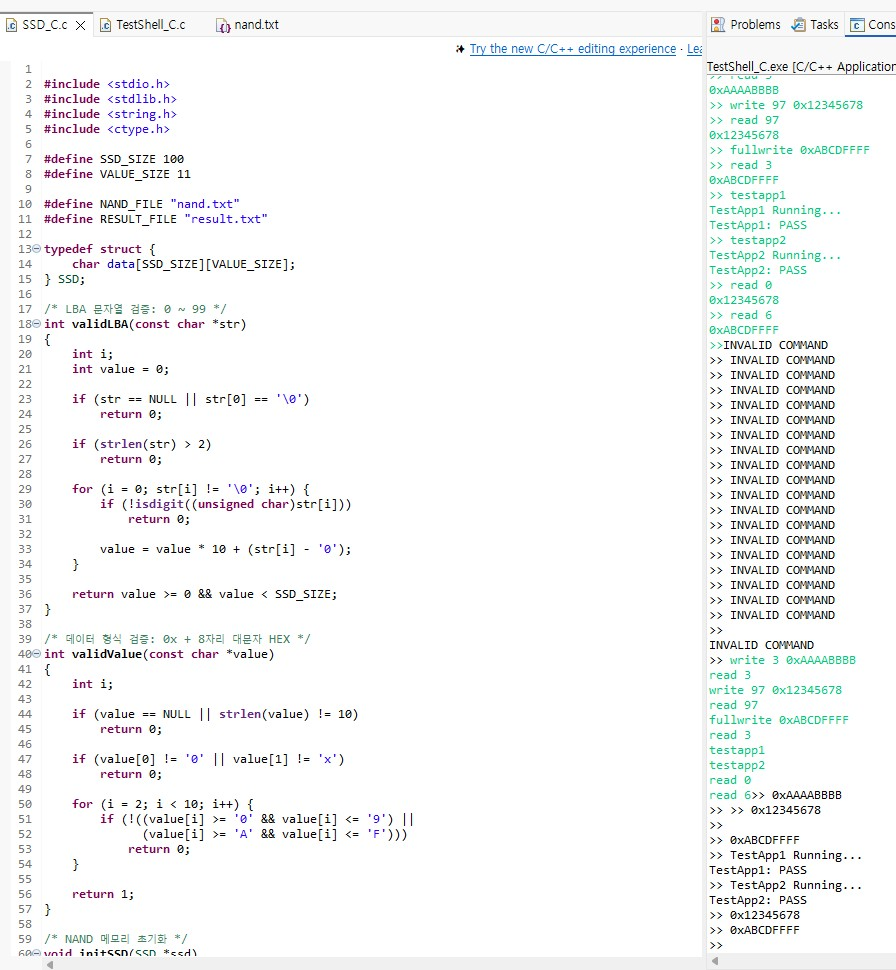

# Virtual SSD Test Shell

텍스트 파일을 NAND 메모리처럼 사용하는 **가상 SSD**와, 이를 명령어로 검증하는 **Test Shell**을 C로 구현한 프로젝트입니다.

- 과정: SSAFY 16기 임베디드 트랙, 임베디드 C언어
- 인원: 1명 (과제는 2인 1조였지만 설계부터 테스트까지 혼자 진행)
- 언어 / 환경: C, Windows, Eclipse CDT

---

## 1. 구조와 동작 흐름


- `ssd.exe`: 한 번 실행할 때 명령 하나(`W` 또는 `R`)를 처리하는 가상 SSD
- `TestShell.exe`: 사용자 명령을 받아 `ssd.exe`를 실행하고, **종료 코드**와 **result.txt**로 결과를 받는 셸
- `nand.txt`: SSD의 NAND 메모리 역할 (Write 결과 저장)
- `result.txt`: 마지막 Read 결과 한 줄

---

## 2. 내가 맡은 역할 (1인 전담)

**가상 SSD (`src/ssd.c`)**
- `ssd W [LBA] [값]`, `ssd R [LBA]` 명령행 인터페이스와 종료 코드(0/1) 설계
- nand.txt 저장 형식 설계: 100줄, 줄 번호 = LBA, 안 쓴 칸은 `0x00000000`
- 임시 파일(`nand.txt.tmp`)에 먼저 쓰고 교체하는 저장 방식 구현

**Test Shell (`src/TestShell.c`)**
- `write / read / fullwrite / fullread / testapp1 / testapp2 / help / exit` 명령 처리
- `system()`으로 ssd.exe 실행, 종료 코드와 result.txt로 결과 수신

**입력 검증**
- 셸과 SSD 양쪽에서 LBA와 값 형식을 이중 검증, 잘못된 입력은 `INVALID COMMAND`

**테스트 시나리오**
- testapp1(전체 쓰기 후 비교), testapp2(반복 쓰기, 덮어쓰기 후 비교)

---

## 3. 핵심 구현

### 데이터 규격
| 항목 | 규격 |
|---|---|
| LBA | 0 ~ 99, 10진수 |
| 값 | `0x` + 대문자 HEX 8자리 (예: `0x1234ABCD`) |
| 초기값 | 한 번도 안 쓴 LBA는 `0x00000000` |

### 가상 SSD 명령
| 명령 | 동작 |
|---|---|
| `ssd W 3 0xAAAABBBB` | nand.txt를 읽어 LBA 3 값을 바꾼 뒤 100줄 전체를 다시 저장 |
| `ssd R 3` | LBA 3 값을 result.txt에 한 줄로 덮어쓰기 |
| 형식 오류 | `INVALID COMMAND` 출력, 종료 코드 1 |

### nand.txt 형식과 저장 방식
```
0x12345678   ← LBA 0
0x12345678   ← LBA 1
...
0x00000000   ← LBA 99
```
- 값이 정확히 100개가 아니거나 형식이 틀리면 `NAND FILE ERROR`
- `nand.txt.tmp`에 전체를 쓰고 → 기존 파일 삭제 → 이름 변경. 쓰는 도중 실패해도 기존 데이터가 남음

### Test Shell 명령
| 명령 | 동작 |
|---|---|
| `write [LBA] [값]` | 한 LBA에 쓰기 |
| `read [LBA]` | 한 LBA를 읽어 값 출력 |
| `fullwrite [값]` | LBA 0~99 전체에 같은 값 쓰기 |
| `fullread` | LBA 0~99 전체 출력 (`LBA n : 값`) |
| `testapp1` | `0xABCDFFFF` 전체 쓰기 → 전부 읽어 비교 → PASS/FAIL |
| `testapp2` | LBA 0~5에 `0xAAAABBBB` 30회 쓰기 → `0x12345678` 덮어쓰기 → 비교 → PASS/FAIL |
| `help` | 명령 목록 출력 |
| `exit` | 종료 |

### 입력 처리
- `fgets()`로 최대 255글자 입력, 넘치면 남은 입력을 버리고 거부
- `strtok()`으로 공백 기준 분리, 단어가 4개를 넘거나 명령별 인자 개수가 틀리면 거부
- LBA는 숫자인지 먼저 확인한 뒤 `atoi()`로 변환

명령별 검증 규칙, 출력 메시지, 종료 코드는 [상세 구현 명세](docs/detailed_spec.md)에 정리했습니다.

---

## 4. 어려웠던 문제

<!-- TODO: 직접 작성 -->
(작성 예정)

---

## 5. 결과



- `write 3 0xAAAABBBB` → `read 3` = `0xAAAABBBB`
- `fullwrite 0xABCDFFFF` → `read 3` = `0xABCDFFFF`
- **testapp1 PASS, testapp2 PASS**
- testapp2 후 `read 0` = `0x12345678`(덮어쓴 범위), `read 6` = `0xABCDFFFF`(범위 밖은 그대로)
- 잘못된 입력은 모두 `INVALID COMMAND`로 처리되고 프로그램이 종료되지 않음

---

## 6. 배운 점

- **프로세스 분리와 통신**: 테스트 도구와 테스트 대상을 별도 프로그램으로 나누고, 종료 코드와 파일로 결과를 주고받는 구조를 직접 설계했습니다.
- **파일 입출력으로 저장 장치 흉내 내기**: `fopen / fprintf / fscanf / remove / rename`으로 저장 형식을 정하고, 저장 도중 실패에 대비하는 방법을 고민했습니다. Windows의 `rename()`은 대상 파일이 있으면 실패해서 먼저 지워야 했고, 그 사이에 위험 구간이 남는다는 점도 알게 됐습니다.
- **방어적 입력 처리**: `fgets`, `strtok`, `isdigit`, 폭을 지정한 `fscanf("%10s")`로 길이와 형식을 먼저 검증해 잘못된 입력에도 죽지 않는 셸을 만들었습니다.
- **자동 테스트**: 반복 쓰기와 덮어쓰기 같은 패턴을 testapp으로 만들어 PASS/FAIL로 판정했습니다.

---

## 빌드와 실행

> `src/TestShell.c`의 `SSD_PATH`, `SSD_DIR`은 개발 PC 기준 절대 경로입니다. 실행 전에 본인 환경에 맞게 바꿔야 합니다.

```bat
gcc src\ssd.c -o SSD_C.exe
gcc src\TestShell.c -o TestShell.exe
TestShell.exe
```

```
>> write 3 0xAAAABBBB
>> read 3
0xAAAABBBB
>> testapp1
TestApp1 Running...
TestApp1: PASS
```

---

## 개선할 점
- 실행 파일 경로 하드코딩 제거 (실행 위치 기준 상대 경로 또는 인자로 받기)
- 기존 파일 삭제와 이름 변경 사이에 종료되면 nand.txt가 사라지는 문제
- fullwrite 한 번에 ssd.exe를 100번 실행하는 비용
- 다음 단계: Linux nandsim 위에서 NAND 규칙(페이지 쓰기, 블록 지우기)을 지키는 FTL로 확장
